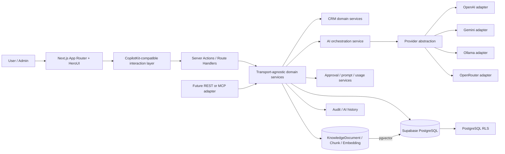
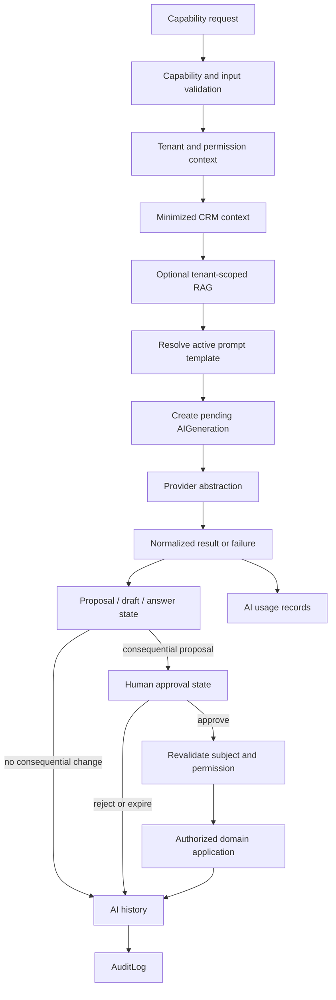
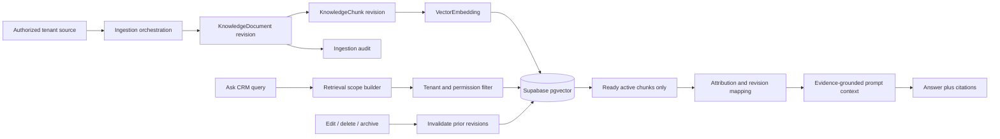
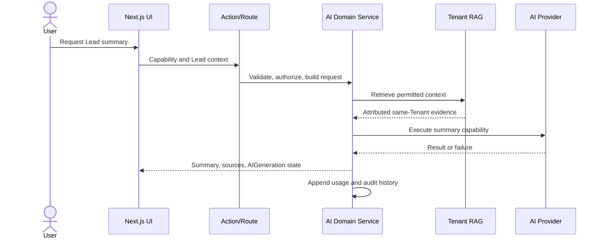
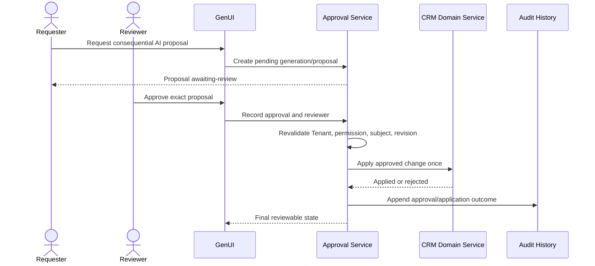
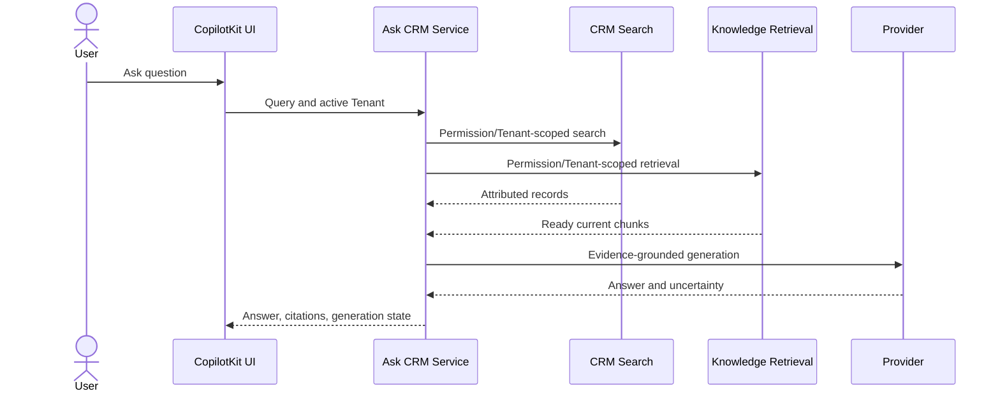
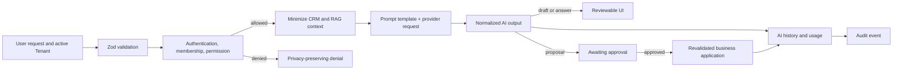
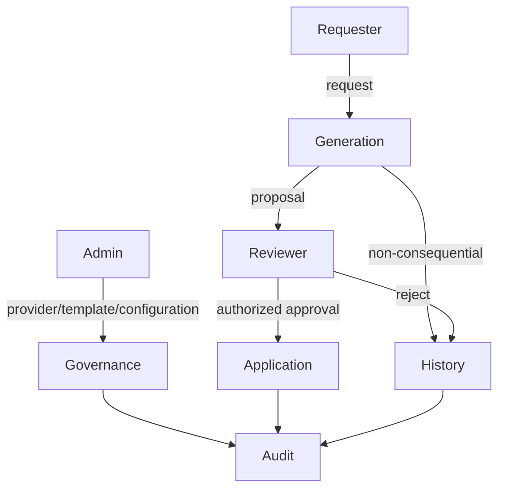

# CRM Nexus AI Platform & GenUI Specification

**Feature Branch**: `001-crm-nexus-ai-genui`
**Created**: 2026-11-21
**Status**: Draft
**Input**: Complete CRM Nexus AI Platform and generative UI specification for a provider-agnostic, tenant-isolated CRM.

## Executive Summary

CRM Nexus is an AI-native multi-tenant SaaS CRM for the Lead → Contact → Deal lifecycle. This specification defines the V1 AI platform, approved AI experiences, tenant-scoped RAG foundation, traceability, governance, and provider/transport independence required for Lead Summary, Lead Scoring, Notes Summarization, Email Generation, Ask CRM, and AI History.

The AI platform uses a provider abstraction and tenant-scoped domain services. It presents proposal, review, approval, and outcome states rather than allowing models to mutate CRM business data autonomously. Retrieval is tenant- and permission-scoped. Every generation and consequential review decision is traceable through canonical append-only AI entities and audit events. The architecture remains compatible with CopilotKit, Next.js App Router, Supabase, pgvector, Server Actions, and route handlers without binding domain behavior to a UI or transport.

## Goals

- Provide six V1 AI capabilities while preserving human accountability and canonical CRM rules.
- Isolate providers, prompts, retrieval, usage, history, UI, and domain services by Tenant.
- Make every AI-assisted consequential change require explicit same-Tenant authorized human approval.
- Preserve append-only AI history and audit provenance for request, result, review, application, failure, and cancellation.
- Support OpenAI, Gemini, Ollama, and OpenRouter through replaceable provider adapters.
- Enable future RAG, MCP, API, automation, and agent transports to reuse the same domain services.
- Deliver accessible, responsive, keyboard-operable, light/dark generative UI experiences.

## Scope

### In Scope

- AI Provider configuration and health state for tenant administrators.
- Versioned tenant prompt templates for supported AI capabilities.
- Lead Summary and Lead Scoring.
- Notes Summarization.
- Email Generation.
- Ask CRM question answering.
- AI History and review status.
- Tenant-scoped RAG for explicitly registered, authorized knowledge sources.
- Provider usage capture and generation traceability.
- CopilotKit-compatible action/rendering contracts and human-in-the-loop review.
- Append-only audit and usage records.

### Out of Scope

- Automatic application of model-proposed CRM changes.
- Autonomous workflow automation or agent execution beyond one explicit user-requested capability.
- Payment, WhatsApp, voice calling, workflow automation engine, marketplace, multi-region infrastructure, or multi-language support.
- MCP server deployment.
- Public or cross-Tenant knowledge sources.
- Silent model replacement or hidden fallback that changes approved output semantics.

## User Scenarios & Testing *(mandatory)*

### User Story 1 - Summarize and score a Lead (Priority: P1)

A sales user opens an authorized Lead and requests a summary or score. The system retrieves only permitted CRM content for that Tenant, produces a reviewable generation, and records provider and prompt provenance.

**Why this priority**: Lead understanding and prioritization are primary V1 sales productivity flows.

**Independent Test**: With two mock Tenants and mocked providers, request summaries and scores and verify Tenant scope, permission enforcement, provenance, and score presentation.

**Acceptance Scenarios**:

1. **Given** an authorized sales user viewing a Lead, **When** they request a summary, **Then** the system displays a concise, source-attributed summary and creates an `AIGeneration` trace.
2. **Given** a Lead with sufficient CRM data, **When** the user requests a score, **Then** the system returns a reviewable score and explanation with no automatic change to CRM fields.
3. **Given** a user lacks Lead permission or is in the wrong Tenant context, **When** they request AI, **Then** no generation or Lead data is exposed.

### User Story 2 - Summarize notes and generate an email (Priority: P1)

A user requests a transient on-demand summary of an authorized Note or drafts an email for a Lead, Contact, or Deal. Note summaries are returned only in the request response; summary text is not retained in AI History, audit, or CRM, and is not indexed, embedded, or used as a retrieval source. Email output is reviewable and is never sent or persisted to CRM as a consequential action without approval.

**Why this priority**: These capabilities reduce repetitive communication and review work.

**Independent Test**: Summarize Notes and generate email drafts for a mock Tenant; verify Note summaries cite the exact source revision and remain transient, source scoping, and that sending or saving email requires separate approval.

**Acceptance Scenarios**:

1. **Given** an authorized, current Note revision, **When** the user requests a summary, **Then** the system returns an on-demand transient summary citing that revision without retaining summary text in AI History, audit, or CRM, or indexing it; a changed or deleted source revision is rejected as stale.
2. **Given** a user requests an email draft, **When** the generation completes, **Then** the draft remains unapplied and editable until the user explicitly confirms save or send intent.
3. **Given** a send or consequential save action, **When** the user has not approved it, **Then** no external message is sent and no CRM record changes.

### User Story 3 - Ask CRM questions (Priority: P1)

An authorized user asks a natural-language question about permitted CRM records or tenant knowledge. The answer states source scope and provenance and rejects unsupported cross-Tenant or out-of-permission requests.

**Why this priority**: Ask CRM demonstrates the integrated retrieval and conversational experience.

**Independent Test**: Issue asks against tenant-isolated CRM and RAG fixtures and verify citations, denial behavior, empty results, and no cross-Tenant leakage.

**Acceptance Scenarios**:

1. **Given** the user asks for permitted CRM information, **When** relevant records exist, **Then** the answer includes attributable CRM and knowledge sources.
2. **Given** a question requiring no available or permitted context, **When** Ask CRM responds, **Then** it states insufficient evidence rather than inventing a record.
3. **Given** content exists only in another Tenant or outside the user's permission, **When** the user asks, **Then** the content is neither retrieved nor acknowledged.

### User Story 4 - Review and govern AI history (Priority: P1)

An authorized user or administrator reviews AI requests, statuses, approvals, rejections, provider usage, failures, and audit decisions.

**Why this priority**: Auditability is required for safe operation and human accountability.

**Independent Test**: Execute generation and approval scenarios with mocked providers and verify append-only history, immutable template references, and restricted views.

**Acceptance Scenarios**:

1. **Given** an AI operation completed or failed, **When** an authorized user opens AI History, **Then** the status, capability, requester, provider/model metadata, timestamps, and review state are visible.
2. **Given** a consequential proposal, **When** a reviewer approves or rejects it, **Then** the decision identifies reviewer and time and cannot be silently replaced.
3. **Given** a usage or audit correction, **When** needed, **Then** the system uses a compensating append-only record rather than rewriting the original.

### User Story 5 - Configure providers and templates (Priority: P2)

A tenant administrator enables supported providers and manages versioned prompt templates for tenant-authorized capabilities.

**Why this priority**: Provider selection and prompt governance must exist without coupling domain behavior to vendors.

**Independent Test**: Enable/disable each mock provider and publish new prompt versions; verify secrets are hidden and published prompt versions remain immutable.

**Acceptance Scenarios**:

1. **Given** an authorized tenant administrator, **When** they configure a provider, **Then** only tenant-owned non-secret settings are retained and provider credentials remain protected.
2. **Given** an active prompt template, **When** edited, **Then** a new version is created and prior generations retain exact provenance.
3. **Given** a provider is disabled or unavailable, **When** generation is requested, **Then** the system reports failure without attempting another provider unless the user explicitly selects a fallback policy.

### User Story 6 - Register tenant knowledge for RAG (Priority: P2)

A tenant administrator registers eligible non-Note sources into a revisioned knowledge index. Notes are not indexable or retrievable by Ask CRM in V1. Retrieval excludes stale, deleted, failed, or cross-Tenant content.

**Why this priority**: RAG is the foundation for Ask CRM and future knowledge features.

**Independent Test**: Index mock documents for two Tenants and verify document/chunk/embedding lifecycle and authorization before retrieval.

**Acceptance Scenarios**:

1. **Given** an authorized tenant source, **When** ingestion completes, **Then** document, chunk, and embedding provenance retain Tenant and content revision.
2. **Given** a source is edited or deleted, **When** retrieval is evaluated, **Then** old chunks and embeddings are stale and ineligible.
3. **Given** a content source is pending or failed, **When** Ask CRM searches, **Then** it is never returned as indexed evidence.

### Edge Cases

- A provider times out or returns invalid, truncated, or disallowed output: generation is failed or cancelled with attributable diagnostics and no CRM application.
- A model proposes changes outside the capability contract: proposal is rejected and not rendered as an applicable action.
- An approval occurs after source data, permission, or provider configuration changes: revalidation is required before application.
- A Lead is converted or deleted while generation is pending: the generation is cancelled or remains unapplied until the subject is revalidated.
- A user belongs to multiple Tenants: every operation requires an explicit active Tenant context and cannot inherit an ambiguous or stale tenant.
- RAG retrieval has no ready evidence: the answer is constrained to available information or explicitly states insufficiency.
- Duplicate or conflicting CRM facts are present: attribution remains visible and no silent merge occurs.
- An audit write fails for a critical decision: the user sees an explicit failure and the decision is not reported as successfully applied.

## Requirements *(mandatory)*

### Functional Requirements

- **FR-001**: The system MUST provide Lead Summary, Lead Scoring, Notes Summarization, Email Generation, Ask CRM, and AI History as tenant-scoped V1 capabilities.
- **FR-002**: Every generation MUST create or update the canonical `AIGeneration` trace with Tenant, requester, capability, status, request time, provider state, template version where used, outcome, and review state.
- **FR-003**: AI invocation MUST use a provider-independent interface supporting OpenAI, Gemini, Ollama, and OpenRouter adapters.
- **FR-004**: The system MUST retain tenant-owned prompt-template versions and resolve the exact immutable active version used by each template-driven generation.
- **FR-005**: Generated summaries and answers MUST include attributable source references to the same-Tenant CRM records or knowledge revisions used.
- **FR-006**: Lead Summary MUST summarize only Lead content and directly related permitted CRM subjects allowed by the capability contract.
- **FR-007**: Lead Scoring MUST produce an explainable score and factors but MUST NOT silently change Lead fields.
- **FR-008**: Notes Summarization MUST be an on-demand transient capability that uses only an authorized, current Note revision, cites that exact revision, and MUST NOT expose deleted, stale, or out-of-scope Notes. Summary text MUST be returned only in the request response and MUST NOT be retained in AI History, audit, or CRM, indexed, embedded, or used as a retrieval source. The generation trace MAY retain outcome metadata and the source Note identity/revision. Note content MUST NOT be used by other V1 AI capabilities.
- **FR-009**: Email Generation MUST produce a reviewable draft and MUST require separate explicit user confirmation before CRM persistence or external sending.
- **FR-010**: Ask CRM MUST perform tenant- and permission-scoped retrieval, reject unsupported questions, and report insufficient evidence instead of fabrication.
- **FR-011**: The system MUST preserve AI History as append-only operational history; corrections and voiding MUST use compensating records.
- **FR-012**: No AI-generated consequential CRM change MAY be applied before an authorized same-Tenant human approves the exact proposal.
- **FR-013**: Approval records MUST identify reviewer, time, approved proposal revision, and application outcome.
- **FR-014**: Rejected or expired proposals MUST remain unapplied and MUST NOT be retried as approved actions.
- **FR-015**: Provider credentials and secrets MUST remain outside prompt, AI result, audit, usage, and error payloads.
- **FR-016**: Provider selection and model aliases MUST be tenant-owned configuration and MUST not alter domain rules.
- **FR-017**: Retrieval MUST include only ready embeddings for active, authorized, non-deleted document and chunk revisions in the requesting Tenant.
- **FR-018**: Knowledge source edits, archive, deletion, or invalidation MUST mark prior retrieval artifacts stale and exclude them immediately.
- **FR-019**: V1 MUST NOT generate embeddings or RAG responses from Notes. V1 MAY generate transient on-demand Note Summaries that are not indexed, embedded, or used as retrieval sources. Future-derived artifacts MUST reference the source Note revision and become stale when that revision changes or is deleted.
- **FR-020**: All generation, review, application, provider configuration, template publication, and knowledge lifecycle decisions MUST emit attributable audit events.
- **FR-021**: Usage quantities, provider identity, model, latency, and cost when available MUST be recordable through canonical `AIUsageRecord` entries.
- **FR-022**: Usage corrections MUST be compensating and auditably attributable.
- **FR-023**: Business-domain behavior MUST be implemented in reusable services independent of Server Actions, route handlers, CopilotKit, provider SDK, REST, or future MCP adapters.
- **FR-024**: CopilotKit-compatible UI experiences MUST represent tool calls, proposals, approval, completion, failure, and cancellation with explicit state.
- **FR-025**: The system MUST support service and transport mocking so provider, identity, and browser flows can be tested without live external calls.
- **FR-026**: The system MUST validate all external input and persisted data crossing trust boundaries using runtime validation.
- **FR-027**: User-facing experiences MUST support keyboard navigation, semantic structure, responsive layout, and light/dark themes.
- **FR-028**: The system MUST explicitly report provider, data, authorization, validation, timeout, cancellation, and audit failures.
- **FR-029**: Soft-deleted CRM records MUST be excluded immediately from AI context and Ask CRM retrieval.
- **FR-030**: A future REST API or MCP adapter MUST be able to call the same domain services and tenant/permission checks without duplicating business rules.

### Key Entities *(include if feature involves data)*

- **AIGeneration**: canonical append-only operation trace owned by Tenant and requester.
- **AIProvider**: Tenant-owned provider configuration, enabled state, capability/model preferences, and lifecycle.
- **AIPromptTemplate**: immutable, versioned Tenant-owned prompt template with active lifecycle state.
- **AIUsageRecord**: append-only provider usage and reconciliation record owned by Tenant.
- **KnowledgeDocument**: Tenant-owned source document bound to a content revision and ingestion lifecycle.
- **KnowledgeChunk**: Tenant-owned attributable source segment bound to a document revision.
- **VectorEmbedding**: Tenant-owned vector representation bound to chunk and embedding-model revision.
- **AuditLog**: attributable record of critical AI, CRM, governance, and knowledge decisions.
- **Lead / Contact / Deal / Activity / Note**: canonical CRM entities and relationships from the approved domain model.

### Domain Model Alignment

- **Canonical model**: `specs/1-domain-model/spec.md` is the authoritative business-domain reference.
- **Entities and relationships used**: AIProvider, AIPromptTemplate, AIGeneration, AIUsageRecord, KnowledgeDocument, KnowledgeChunk, VectorEmbedding, Lead, Contact, Deal, Activity, Note, AttachmentMetadata, and AuditLog.
- **No model changes**: This specification adds no entity, ownership, lifecycle, relationship, or cardinality beyond the canonical model. Implementation must reuse these names and semantics.
- **Proposed model changes**: None. Any change to entity meaning, ownership, lifecycle, or relationships requires a domain-model amendment.

### Scope & Non-Goals

- **In Scope**: Provider abstraction, prompt governance, all six V1 AI features, RAG foundations, human approval state, AI history, audit, usage, UI architecture, and future transport reuse.
- **Out of Scope**: MCP deployment, autonomous CRM mutation, external email delivery integration as a V1 domain capability, workflow automation, non-SaaS CRM operations, and the Constitution's V1 non-goals.

### Architecture & Quality Requirements *(as applicable)*

- **Tenant Isolation**: Tenant identity is mandatory in every data access, search, prompt, cache, retrieval, provider call, audit, and generated proposal.
- **AI Behavior**: Provider abstraction, exact prompt provenance, mockability, tenant-scoped retrieval, explicit approval, and append-only history are mandatory.
- **Validation**: Zod validates transport input, capability arguments, provider responses, proposal payloads, and persisted trust-boundary values.
- **Accessibility & Themes**: WCAG-oriented keyboard and semantic behavior, mobile-first layouts, and light/dark theme compatibility.
- **Testing**: Vitest unit/integration tests, Playwright browser tests, and aimock provider tests cover workflows and cross-Tenant denial.

## Architecture Overview

The Next.js application owns presentation and transport adaptation. Server Components provide context and read-only surfaces where beneficial; Client Components and CopilotKit host interactive AI review. Server Actions and route handlers validate input and invoke authorized domain services; they do not implement CRM or AI business rules.

Domain services enforce active Tenant context, membership, permissions, revision revalidation, and same-Tenant relationships. The AI orchestration service resolves capability, prompt template, provider, retrieval scope, data minimization, and expected output contract. Provider adapters translate provider-specific APIs and normalize provider-neutral results and failures.

Approval is a domain state and service boundary, not a UI-only flag. A proposal identifies its exact generation and affected subject(s). Approval is followed by revalidation and transport-independent application logic.

## AI Architecture Diagram

## RAG Architecture Diagram

Retrieval always combines Tenant identity, source authorization, document/chunk revision state, and user permission. Vector similarity ranking occurs only after those eligibility boundaries are established.

## Sequence Diagrams

### Lead Summary

### Human Approval

### Ask CRM

## Data Flow Diagrams

Sensitive CRM values, secrets, raw prompts, and raw model outputs flow only into permitted processing references and are minimized or omitted from audit and logs according to Tenant data policy.

## Tool Architecture

AI capabilities are exposed through capability contracts, not provider-specific tools. Each tool has a stable identity, declared inputs, result shape, required permissions, Tenant scope, audit behavior, and approval policy.

- **lead.summary**
- **lead.score**
- **notes.summarize**
- **email.generate**
- **crm.ask**
- **ai.history.read**
- **ai.generation.cancel**
- **knowledge.source.retrieve** (read-only foundational capability)

Consequential CRM operations remain existing CRM domain actions invoked only after approval. Tool contracts validate inputs and contain no direct database or provider implementation. Future MCP tools adapt these domain services but do not duplicate rules.

## Prompt Architecture

- Prompt template entities are Tenant-owned, versioned, active, immutable once published, and attributable.
- Templates declare input names, output expectations, capability, and permitted source types.
- System and capability instructions are separated from untrusted CRM/RAG content.
- Context assembly includes only the minimum permitted, same-Tenant fields and explicit source identifiers.
- Prompt payloads do not include provider credentials or secrets.
- Generated output is validated against a capability-specific contract.
- Draft, score, summary, answer, and proposal outputs are stored only through permitted references or summaries.
- Exact template version, provider, model alias, and capability are retained in `AIGeneration` provenance.

## Governance Model

- Tenant administrators control provider configuration and enabled capabilities.
- Authorized users may request AI capabilities permitted by role and subject.
- Consequential proposals require an authorized reviewer who may be the requester only if permissions and explicit UI confirmation allow it; no policy bypass is permitted.
- Approvals apply once and do not become implicit standing authorization.
- Prompt activation and provider changes are auditable and tenant-scoped.
- Data-policy decisions govern whether raw prompts or outputs are retained.

## Audit Architecture

Critical events include generation request, provider execution, success/failure/cancellation, review decision, proposal application, provider/template configuration, usage creation/reconciliation/voiding, knowledge lifecycle transitions, and deletion/restoration.

Each audit event records Tenant, actor or system process, timestamp, action, target, and minimized change summary. Raw secrets, credential values, provider payloads, and unnecessary personal content are prohibited.

AI history is append-oriented through `AIGeneration` and `AIUsageRecord`; materialized UI views are derived, never authoritative. Corrections use compensating records. Critical audit failures are visible and prevent reporting an approved application as successful.

## Security Considerations

- Authentication, active membership, role/permission checks, service authorization, and PostgreSQL RLS form layered tenant enforcement.
- Tenant context originates from authenticated server state and active membership, never a caller-supplied tenant identifier.
- Cross-Tenant references are prohibited for all canonical AI, CRM, and knowledge entities.
- Input and provider output are runtime-validated.
- Credentials reside in protected server configuration or secrets storage and never enter audit or model context.
- Prompt injection from CRM or knowledge content is treated as untrusted data; retrieved text does not gain instructions or tool authority.
- AI tools execute read-only retrieval or draft/summary operations unless a domain approval boundary explicitly authorizes an existing CRM action.
- Search and cache keys preserve Tenant, user permission scope, content revision, and deleted/stale state.
- AI actions are attributable and privacy-minimized.
- RLS and application checks are tested across users who belong to multiple Tenants.

## Non-Functional Requirements

- **NFR-001 — Tenant isolation**: 100% of AI, RAG, usage, history, and provider operations reject cross-Tenant access.
- **NFR-002 — Provider replacement**: Replacing an adapter MUST not change CRM domain services or approval semantics.
- **NFR-003 — Availability**: Provider failure MUST not corrupt CRM state or falsely report application.
- **NFR-004 — Type safety**: TypeScript and Zod are used for trust boundaries and persisted values.
- **NFR-005 — Testability**: Live providers are never required for unit or integration tests; aimock is preferred.
- **NFR-006 — Traceability**: 100% of successful, failed, cancelled, and approved generations are traceable to capability and requester.
- **NFR-007 — Retrieval privacy**: 100% of RAG eligibility is constrained by Tenant, permission, and current revision.
- **NFR-008 — Append-only history**: Original AI and usage records are never silently rewritten.
- **NFR-009 — Accessibility**: WCAG 2.2 AA practices apply to AI surfaces and approval controls.
- **NFR-010 — Responsive UI**: Core AI experiences remain usable on mobile, tablet, and desktop in light/dark themes.
- **NFR-011 — Observability**: Errors are attributable and measurable while suppressing secrets and unnecessary personal data.
- **NFR-012 — Transport independence**: The same domain behavior is accessible through Server Actions and future adapters.

## Performance Requirements

- **User-facing performance**: Generations show loading and cancel states immediately; text streaming or progress feedback begins within 2 seconds where supported.
- **Ask CRM**: 95% of normal tenant-scoped Ask CRM requests return an answer or transparent failure within 10 seconds.
- **Summaries and drafts**: 95% complete or return a provider/result failure within 15 seconds for normal context sizes.
- **Lead Scoring**: 95% complete or return a provider/result failure within 15 seconds.
- **RAG retrieval**: Eligible evidence retrieval completes within 1 second at the expected V1 tenant volume, independent of provider latency.
- **History**: The latest 100 AI history entries load within 2 seconds for normal tenants.
- **Capacity**: The platform is performance-tested at the Tenant and usage volume defined during implementation planning; no cross-Tenant capacity sharing is permitted.

## Acceptance Criteria

- AC-001: All six V1 capabilities produce correct, tenant-scoped, attributable results or privacy-preserving failures.
- AC-002: Cross-Tenant CRM, RAG, provider, history, usage, and audit access is rejected in automated tests.
- AC-003: No consequential CRM mutation occurs without explicit approval of the exact proposal.
- AC-004: Rejection, expiration, cancellation, and failure leave CRM state unchanged.
- AC-005: Provider, template, generation, usage, and audit records use canonical domain entity semantics.
- AC-006: Summaries and Ask CRM answers include sources for factual evidence or state insufficiency.
- AC-007: Edited, deleted, stale, archived, pending, or failed knowledge revisions are excluded from retrieval tests.
- AC-008: Provider and AI dependencies are mockable and tests do not require live external services.
- AC-009: Mobile, tablet, desktop, keyboard, and light/dark behavior pass usability checks.
- AC-010: Future REST/MCP adapters can invoke shared domain services without transport-specific business logic.

## Risks

- **Provider inconsistency**: Model output quality varies; mitigated by capability contracts, validation, evidence citations, and mock tests.
- **Prompt injection**: Retrieved content may attempt to override instructions; mitigated by untrusted-context separation and tool authorization.
- **Tenant leakage**: A missing filter or cache key could expose data; mitigated by RLS, service checks, scoped keys, and isolation tests.
- **Approval drift**: A proposal may change while awaiting review; mitigated by exact revision and subject revalidation.
- **History growth**: Append-only generations and usage may accumulate; mitigated through policy-based retention and compensating records.
- **RAG irrelevance or stale evidence**: Similarity search may find weak sources; mitigated by authorization, revision checks, ranking limits, and insufficiency messaging.
- **Provider outage**: Downtime prevents generation; mitigated by clear failure state, retry controls, and no hidden fallback.
- **Unauthorized external sending**: An AI draft could be treated as sendable; mitigated by separate confirmation and non-consequential draft defaults.

## Assumptions

- Supabase Auth establishes identity and membership, with application authorization and RLS enforcing Tenant boundaries.
- A Tenant's enabled provider configuration may differ from another Tenant.
- Existing CRM permissions determine whether a user may view or mutate a subject.
- Knowledge ingestion is not a real-time guarantee and may occur asynchronously.
- Tenant data policies define raw prompt/output retention, while default behavior minimizes stored content.
- Ollama availability is deployment/environment-specific and is never assumed by domain semantics.
- Standard provider usage quantities are converted into canonical usage measures without silently inventing provider reports.
- Revenue and analytics behavior remain governed by the canonical domain model.

## Open Questions

- None. Tenant data-retention periods, prompt/output retention policy, and exact Tenant usage volume are deployment-policy inputs to be finalized during implementation planning without changing this specification's architecture or rules.

## Future Extensibility Considerations

- Additional providers can be adapters behind the provider abstraction.
- Additional capabilities can reuse the generation, approval, history, usage, prompt, and audit services.
- MCP tools can expose only approved domain operations and inherit authorization and RAG scope.
- REST integrations can use the same capability contracts and domain services.
- Additional knowledge sources can participate when represented through canonical KnowledgeDocument revisions.
- Alternative vector engines or embedding models can coexist through model/revision metadata if canonical retrieval and stale-state semantics remain intact.
- CopilotKit rendering can expand without changing domain or approval contracts.
- Multimodal, multilingual, workflow, or agent capabilities require separate approved specifications and must not weaken the V1 approval boundary.

## Success Criteria *(mandatory)*

### Measurable Outcomes

- **SC-001**: At least 95% of test users complete each primary V1 AI action without losing Tenant context or encountering an unexplained failure.
- **SC-002**: 100% of cross-Tenant isolation test cases reject CRM, RAG, AI history, provider, and usage access.
- **SC-003**: 100% of consequential proposals remain unapplied until an auditably authorized approval is recorded.
- **SC-004**: 100% of generated summaries and Ask CRM answers either identify attributable sources or explicitly state insufficient evidence.
- **SC-005**: 100% of stale, deleted, pending, failed, or archived knowledge revisions are excluded from retrieval tests.
- **SC-006**: 95% of summary, score, draft, and normal Ask CRM operations meet the stated performance targets.
- **SC-007**: WCAG-oriented keyboard, semantic, responsive, and theme checks pass for all AI review surfaces.

### Performance Requirements *(when applicable)*

- **User-facing performance**: Immediate loading/cancellation feedback, streaming or progress feedback when supported, and targets stated above.
- **Data and service performance**: Tenant/permission retrieval and RAG eligibility filtering are measured independently from provider latency and meet the stated targets.

### Security Requirements *(mandatory)*

- **Authentication and Authorization**: Supabase Auth identity, active membership, role, permission, service, RLS, and approval checks are all enforced.
- **Tenant Isolation**: Every read, write, cache, search, prompt, retrieval, history, usage, and audit operation requires exact Tenant context.
- **Input Validation**: Capability input, active Tenant context, proposal payload, provider response, and knowledge state are runtime-validated.
- **Data Protection**: Secrets are protected server-side; audit and logs minimize personal data and exclude credential values.

### UX Requirements *(when user-facing)*

- **Design System**: Next.js App Router, TypeScript, HeroUI, Tailwind CSS, and CopilotKit-compatible interactions.
- **Accessibility**: Keyboard-operable approvals, semantic status, visible focus, readable labels, and WCAG 2.2 AA-oriented behavior.
- **Responsiveness**: Core CRM and AI experiences support mobile, tablet, and desktop viewports.
- **Themes**: AI, approval, history, and GenUI surfaces support light and dark themes without fixed-theme-only controls.
